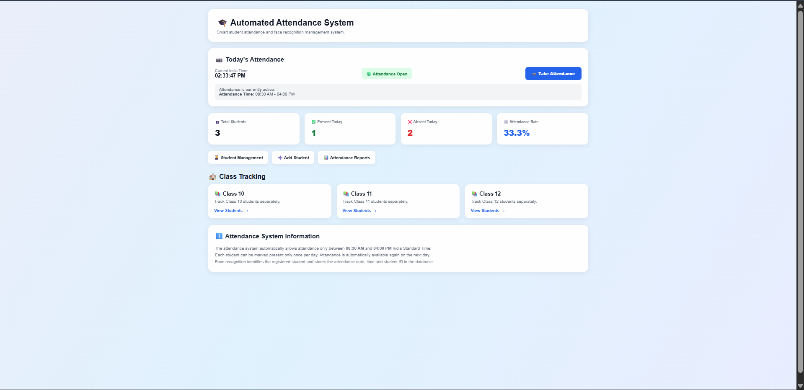
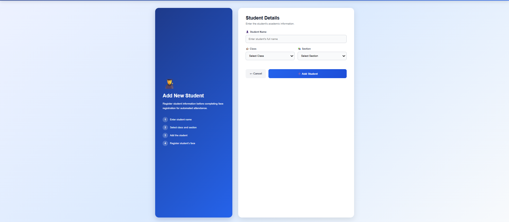
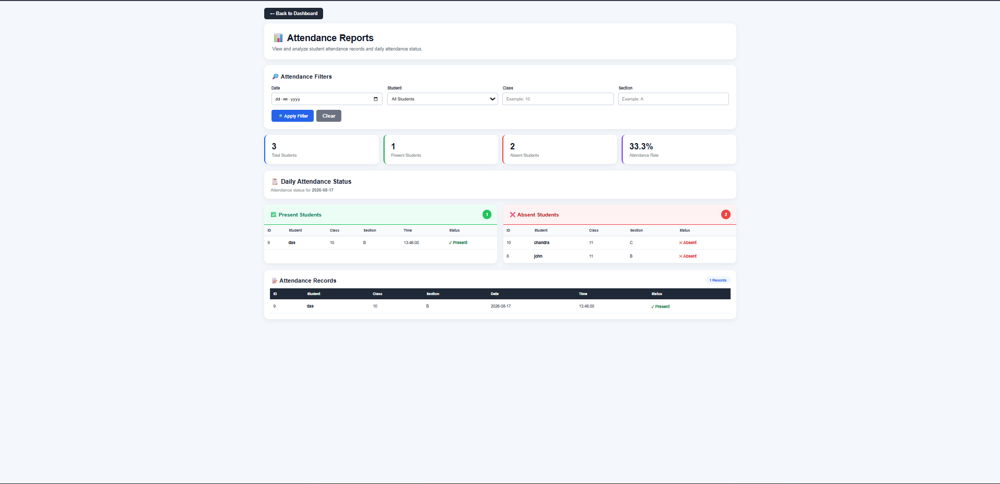

# 🎓 Automated Attendance System

> **AI-powered student attendance management using Face Recognition, OpenCV, Flask, and SQLite.**

An intelligent and automated attendance management system designed to reduce the time and effort required for traditional manual attendance.

The system combines **Computer Vision, Face Recognition, Web Development, and Database Management** to identify registered students and manage attendance efficiently.

---

## 🌟 Project Highlights

* 🤖 AI-based face recognition
* 📷 Real-time camera-based student identification
* 👨‍🎓 Student registration and management
* 📝 Automated attendance recording
* 📊 Attendance and attendance-report management
* 🌐 Flask-based web dashboard
* 🗄️ SQLite database
* 🔐 Local handling of biometric-related data
* 💻 Simple and user-friendly interface

---

# 📸 Application Screenshots

## 🏠 Dashboard



---

## 👨‍🎓 Student Management



---

## 📝 Attendance


---

## 📊 Attendance Report



---

# 📌 Project Overview

Traditional attendance systems require teachers to manually record the presence of students. This can be time-consuming, especially when managing a large number of students.

The **Automated Attendance System** provides a computer-vision-based solution where registered students can be identified through a camera and their attendance can be recorded automatically.

The project is developed as an academic implementation demonstrating the practical application of **Artificial Intelligence and Computer Vision** in education.

---

# 🎯 Problem Statement

Traditional manual attendance systems have several challenges:

* ⏱️ Attendance takes valuable classroom time
* ❌ Manual entry can lead to errors
* 📝 Records require additional maintenance
* 🔄 Managing attendance for multiple students is difficult
* 📊 Generating attendance reports manually takes time
* 👨‍🏫 Teachers need to spend time on repetitive administrative tasks

### Proposed Solution

Use **Face Detection and Face Recognition** to automatically identify registered students and manage their attendance through a web-based system.

---

# 💡 How the System Works

```text
                    ┌─────────────────────┐
                    │   Student Register  │
                    └──────────┬──────────┘
                               ↓
                    ┌─────────────────────┐
                    │  Face Registration  │
                    └──────────┬──────────┘
                               ↓
                    ┌─────────────────────┐
                    │   Train Face Model  │
                    └──────────┬──────────┘
                               ↓
                    ┌─────────────────────┐
                    │   Camera Captures   │
                    │        Face         │
                    └──────────┬──────────┘
                               ↓
                    ┌─────────────────────┐
                    │   Face Detection    │
                    └──────────┬──────────┘
                               ↓
                    ┌─────────────────────┐
                    │  Face Recognition   │
                    └──────────┬──────────┘
                               ↓
                    ┌─────────────────────┐
                    │ Student Identified  │
                    └──────────┬──────────┘
                               ↓
                    ┌─────────────────────┐
                    │ Attendance Recorded │
                    └──────────┬──────────┘
                               ↓
                    ┌─────────────────────┐
                    │ Attendance Reports  │
                    └─────────────────────┘
```

---

# ⚙️ Features

## 👨‍🎓 Student Management

* Add student details
* View registered students
* Manage student records
* Associate students with unique IDs

## 📷 Face Registration

* Capture student facial images using a camera
* Store training images locally
* Associate captured facial data with the corresponding student ID

## 🧠 Face Recognition

* Detect faces using OpenCV
* Recognize previously registered students
* Identify the corresponding student ID
* Display recognition confidence

## 📝 Automated Attendance

* Identify students through the camera
* Record attendance automatically
* Store attendance date and time
* Avoid unnecessary duplicate attendance entries

## 📊 Attendance Reports

* View attendance records
* Maintain attendance history
* Display attendance information in an organized format

## 🌐 Web Dashboard

* Flask-powered web interface
* Centralized dashboard
* Student management interface
* Attendance management interface

---

# 🧠 Technologies Used

| Technology       | Usage                          |
| ---------------- | ------------------------------ |
| 🐍 **Python**    | Core application development   |
| 🌐 **Flask**     | Web application framework      |
| 👁️ **OpenCV**   | Face detection and recognition |
| 🗄️ **SQLite**   | Database management            |
| 🌐 **HTML**      | Web page structure             |
| 🎨 **CSS**       | User interface design          |
| ⚡ **JavaScript** | Frontend functionality         |
| 🔧 **Git**       | Version control                |
| ☁️ **GitHub**    | Source code hosting            |

---

# 🏗️ System Architecture

```text
                         ┌───────────────────┐
                         │    User / Admin   │
                         └─────────┬─────────┘
                                   │
                                   ↓
                         ┌───────────────────┐
                         │    Flask Web App  │
                         └─────────┬─────────┘
                                   │
             ┌─────────────────────┼─────────────────────┐
             ↓                     ↓                     ↓
   ┌─────────────────┐   ┌─────────────────┐   ┌─────────────────┐
   │ Student         │   │ Face Recognition│   │ Attendance      │
   │ Management      │   │ System          │   │ Management      │
   └────────┬────────┘   └────────┬────────┘   └────────┬────────┘
            │                     │                     │
            │                     ↓                     │
            │            ┌─────────────────┐            │
            │            │ OpenCV Camera   │            │
            │            └────────┬────────┘            │
            │                     ↓                     │
            │            ┌─────────────────┐            │
            │            │ Face Detection  │            │
            │            └────────┬────────┘            │
            │                     ↓                     │
            │            ┌─────────────────┐            │
            │            │ Face Recognition│            │
            │            └────────┬────────┘            │
            │                     │                     │
            └─────────────────────┼─────────────────────┘
                                  ↓
                         ┌───────────────────┐
                         │  SQLite Database  │
                         └───────────────────┘
```

---

# 📂 Project Structure

```text
Automated-Attendance-System/
│
├── ai/
│   └── face_detection.py
│
├── templates/
│   ├── dashboard.html
│   └── ...
│
├── static/
│   ├── style.css
│   └── ...
│
├── screenshots/
│   ├── dashboard.png.png
│   ├── student-management.png.png
│   ├── attendance.png.png
│   └── attendance-report.png.png
│
├── data/
│   └── ...
│
├── app.py
├── attendance.py
├── database.py
├── live_recognition.py
├── train_faces.py
├── test_recognition.py
├── requirements.txt
├── .gitignore
└── README.md
```

---

# 🚀 Installation

## 1. Clone the Repository

```bash
git clone https://github.com/sriguganeswar333-pixel/Automated-Attendance-System.git
```

## 2. Navigate to the Project

```bash
cd Automated-Attendance-System
```

## 3. Create a Virtual Environment

### Windows

```bash
python -m venv venv
```

Activate the environment:

```bash
venv\Scripts\activate
```

## 4. Install Dependencies

```bash
pip install -r requirements.txt
```

---

# ▶️ Run the Application

Start the Flask application:

```bash
python app.py
```

The application will normally be available at:

```text
http://127.0.0.1:5000
```

Open the address in your web browser.

---

# 📷 Face Registration Workflow

```text
Select Student
      ↓
Open Camera
      ↓
Capture Face Images
      ↓
Store Training Images
      ↓
Train Face Recognition Model
      ↓
Save Model
```

The trained model is then used for live student recognition.

---

# 🧠 Face Recognition Workflow

```text
Camera
   ↓
Capture Frame
   ↓
Detect Face
   ↓
Process Face
   ↓
Compare With Trained Model
   ↓
Recognize Student
   ↓
Identify Student ID
   ↓
Display Recognition Result
```

---

# 📝 Attendance Workflow

```text
Student Appears
       ↓
Face Detected
       ↓
Face Recognized
       ↓
Student Identified
       ↓
Check Existing Attendance
       ↓
Record Date & Time
       ↓
Attendance Saved
```

---

# 🔐 Privacy & Security

Because the project uses facial recognition, biometric-related information must be handled responsibly.

The following data should remain local and should not be publicly uploaded:

* Student facial images
* Trained face-recognition models
* Attendance database
* Personal student information
* Environment/configuration files containing secrets

The project uses `.gitignore` to prevent sensitive and generated files from being committed to the public repository.

### 🚫 Example excluded files

```text
attendance.db
venv/
__pycache__/
*.pyc
*.yml
.env
data/faces/
```

> Always verify the actual `.gitignore` before pushing the project to a public repository.

---

# 📈 Future Enhancements

The project can be further improved with:

* 📅 Daily, weekly, and monthly attendance filtering
* 📊 Attendance percentage calculation
* 📥 CSV/Excel attendance export
* 👨‍🏫 Teacher and administrator authentication
* 🔔 Automated attendance notifications
* ☁️ Cloud database integration
* 📱 Responsive/mobile-friendly interface
* 🤖 Improved recognition accuracy
* 🧑‍🎓 Detailed student profiles
* 📷 Improved camera and lighting handling
* 🔐 Enhanced biometric-data protection
* 📈 Advanced attendance analytics

---

# 🎓 Educational Purpose

This project demonstrates the practical integration of:

* Artificial Intelligence
* Computer Vision
* Face Recognition
* Python
* Flask
* SQLite
* Web Development
* Database Management
* Git & GitHub

The project is intended as an academic and portfolio project demonstrating how AI and computer vision can be applied to automate real-world educational tasks.

---

# 👨‍💻 Author

## SRIGUGANESWAR.C

**B.Tech – Artificial Intelligence & Data Science**

**Panimalar Engineering College**

---

# ⭐ Project

### Automated Attendance System

```text
Python + Flask + OpenCV + SQLite
```

If you find this project useful, consider giving the repository a ⭐ on GitHub.

---

# 📜 License

This project is developed for **educational and academic purposes**.

---

## 🔗 Repository

**GitHub:**
https://github.com/sriguganeswar333-pixel/Automated-Attendance-System
